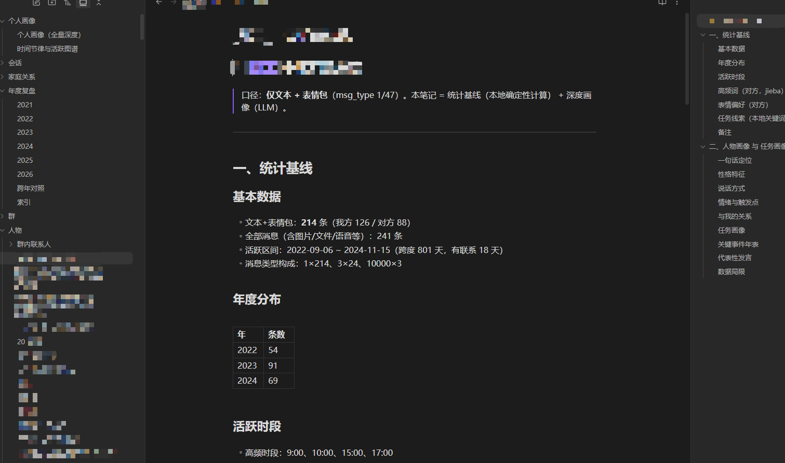

# WeaveVault for WeChat

把微信 4.0 全量聊天记录编织成**可检索、可深挖、可维护**的 Obsidian 个人知识库。

- SkillHub：<https://skillhub.cn/skills/wechat-weave-vault>
- 许可：MIT-0
- 支持平台：Windows / macOS / Linux

## 效果示例

截图为本地跑完刷新管道后生成的「个人画像」笔记：上半部分是**统计基线**（本地确定性计算），下半部分是**深度画像**（LLM 批处理）；两者拼在一篇里，右侧大纲可直接跳章节。
